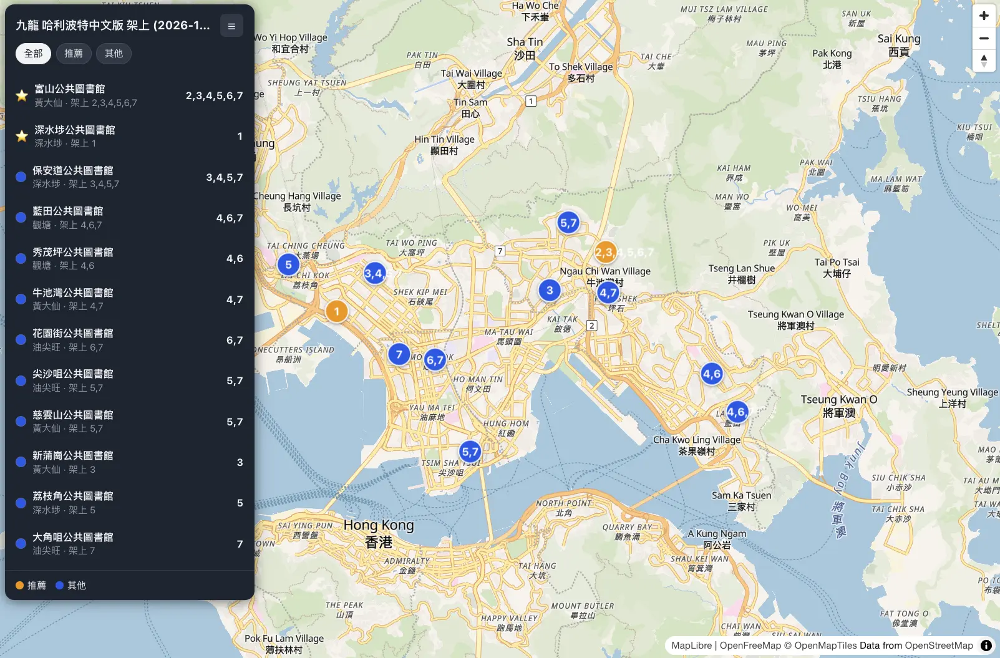
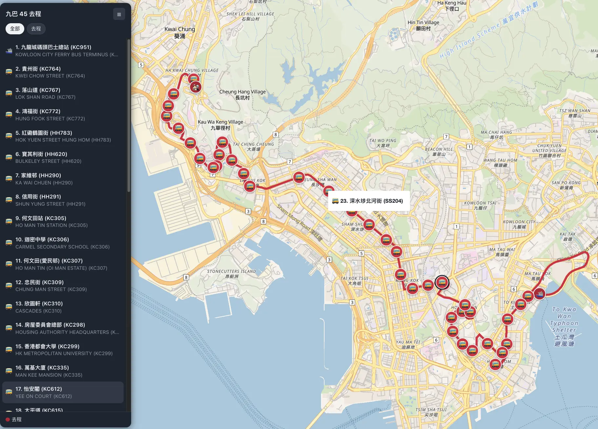
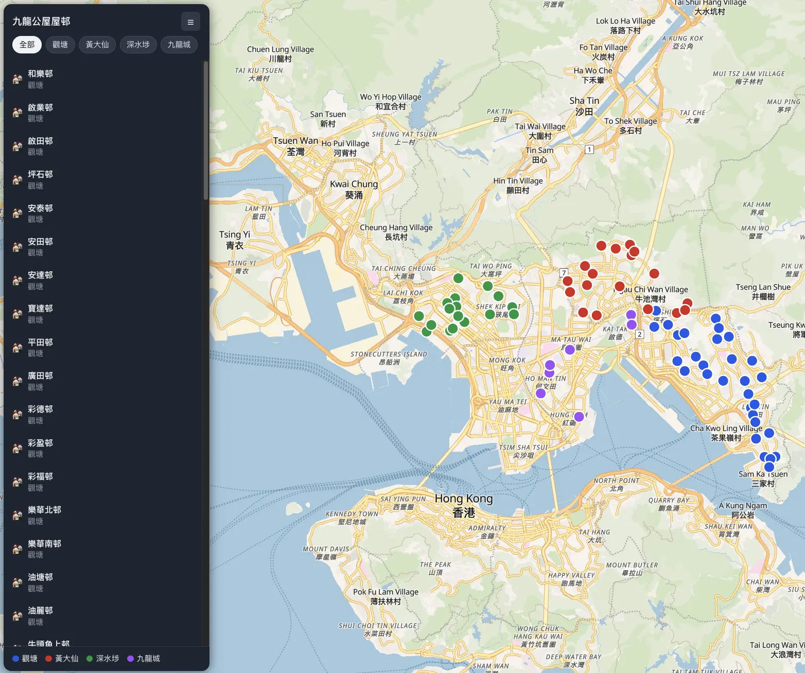

# 🗺️ maplink

**Share a map by sharing a link. The URL _is_ the API.**


A full-screen [MapLibre GL JS](https://maplibre.org/) map where markers, popups,
routes, zones and radius rings are declared **entirely in the query string**. No
backend, no database, no account — paste the link and you get the same map.

```text
https://maplink.app/?m=lat:22.315203|lng:114.181846|emoji:🏢|title:何文田停車場|body:空位 30
&circle=lat:22.315203|lng:114.181846|radius:500|color:%2316a34a|opacity:0.15
```

That link drops a parking pin and shades a 500 m walking ring around it. Swap
`maplink.app` for wherever you deploy — every example below is just a query
string to append to that URL.

## 📷 Real links

<figure>
  
  <figcaption>
    <strong>哈利波特中文版 · 九龍區公共圖書館架上地圖</strong> — public libraries that stock the
    Chinese edition, grouped 推薦 (starred, full set) vs 其他. Each numbered pin
    (<code>label:</code>) tells at a glance which volumes that library holds,
    and panel rows trail their full volume list.
  </figcaption>
</figure>

<figure>
  
  <figcaption>
    <strong>九巴 45 號路線</strong> — one stop per marker (40+ pins) plus one
    line for the bus path; the panel lists every stop and the 去程 chip keeps
    it tidy.
  </figcaption>
</figure>

<figure>
  
  <figcaption>
    <strong>九龍公共屋邨</strong> — 50+ estates grouped by district. Past the
    50-pin limit they render as a GPU circle layer; the district chips + legend
    filter both the list and the map, and the dark palette follows
    <code>prefers-color-scheme</code>.
  </figcaption>
</figure>

## ✨ Why it's nice

- **Link = state.** Reload, bookmark, share or embed it — the map comes back identical.
- **Sharing built in.** `share=1` adds a copy-link button, a QR code, a native
  share sheet and an `<iframe>` snippet; `embed=1` renders the map chrome-free.
- **Nothing to host.** No backend, no API key. Basemaps come from [OpenFreeMap](https://openfreemap.org/) vector tiles.
- **Real street routes.** `route=` resolves driving / walking / cycling routes at
  view time via [routing.openstreetmap.de](https://routing.openstreetmap.de/) — free, no key.
  Add `steps:1` for turn-by-turn instructions.
- **One file of logic.** The entire map lives in [`src/App.tsx`](src/App.tsx)
  (the share popover is the one exception: [`src/share.ts`](src/share.ts), loaded
  lazily so links without `share=1` never download it).
- **It scales.** Past 50 markers, DOM pins automatically upgrade to a GPU `circle` layer.

## 🚀 Run it

```sh
npm install
npm run dev      # http://localhost:5173/
npm run build    # type-check + production build
```

With no params at all, the map falls back to a built-in Victoria Harbour demo
that exercises the three core primitives with grouped categories in the panel —
two markers, a live driving route (one OSRM request at view time) and a 500 m
walking ring.

## 📖 URL API

### The ground rules

- **Repeatable** — each drawable param may appear many times; one object per occurrence.
- **Field syntax** — `key:value` pairs joined by `|`, in any order.
- **Required** — `lat` + `lng` for `m` / `popup` / `circle`; `pts` for `line` / `area`; `from` + `to` for `route`.
- **Forgiving** — unknown keys are ignored and malformed entries are skipped, never errored.
- **Limit** — 100 entries per type (`route`: 10, since each costs the visitor a routing request).
- **Escaping** — write a literal separator as `\|` or `\:`. Popup text is HTML-escaped.
- **Encoding** — non-ASCII just works; only `#` → `%23` and newline → `%0A` need hand-encoding.
- **GeoJSON passthrough** — `json` takes a whole URL-encoded GeoJSON document instead of `key:value` fields (see [section 7](#7-raw-geojson--json)).

### Short field names

Every drawable field has a one-letter alias, and hex colours may drop the `#`. Both
spellings are accepted; AI agents should prefer the short form.

| Long | Short | Long | Short |
| --- | --- | --- | --- |
| `lat` | `a` | `title` | `t` |
| `lng` | `o` | `body` | `b` |
| `label` | `l` | `group` | `g` |
| `emoji` | `e` | `subtitle` | `s` |
| `color` | `c` | `radius` | `r` |
| `scale` | `z` | `pts` | `p` |
| `anchor` | `k` | `width` | `w` |
| `offset` | `f` | `outline` | `u` |
| `rotation` | `q` | `opacity` | `y` |
| `drag` | `d` | `from` | `x` |
| | | `to` | `i` |
| | | `via` | `v` |
| | | `profile` | `h` |
| | | `steps` | `j` |

```text
?m=a:22.315203|o:114.181846|l:30|e:🏢|c:2563eb|t:何文田停車場|g:停車場|b:空位 30
```

Top-level params (`m`, `popup`, `line`, `area`, `circle`, `route`, `json`, `title`,
`panel`, `group`, `center`, `zoom`, `style`, `share`, `embed`, `labels`, `cluster`)
are unchanged.

### Viewport

```text
center={lat}|{lng}   zoom={0–22}   style={bright|positron|liberty}
```

| Param | Meaning | Default |
| --- | --- | --- |
| `center` | Initial map center | Ho Man Tin, Hong Kong |
| `zoom` | Zoom level, `0`–`22` | `14.5` |
| `style` | Basemap: `bright`, `positron` or `liberty` | `bright` |

If drawables exist and no `center` / `zoom` is given, the map **auto-fits
everything**.

### Chrome (share & embed)

```text
share={0|1}   embed={0|1}   labels={0|1}   cluster={0|1}
```

| Param | Meaning | Default |
| --- | --- | --- |
| `share` | Show the **share control** | `0` (off) |
| `embed` | Chrome-free mode for iframes | `0` (off) |
| `labels` | Draw marker labels in GPU mode | `1` (on) |
| `cluster` | Cluster the GPU point layer | `0` (off) |

**`share=1`** adds a small button in the top-right control stack. It opens a
popover with:

- **連結** — the current URL, with a copy button.
- **複製目前視角連結** — the same link with the live `center` / `zoom` baked in
  (the URL never changes on its own, so this is how you share exactly what you
  are looking at).
- **分享…** — the native share sheet, where the browser has one.
- **QR** — the link as a QR code, plus a PNG download.
- **嵌入碼** — an `<iframe>` snippet that embeds this map.

**`embed=1`** is the chrome-free mode meant for `<iframe>` embedding: no
panel, no panel toggle, no share control — the map fills the frame. The map
attribution stays (OpenStreetMap / OpenFreeMap require it).

```html
<iframe src="https://maplink.app/?embed=1&m=lat:22.315203|lng:114.181846|title:何文田停車場"
        width="100%" height="480" style="border:0" loading="lazy"></iframe>
```

**`labels=0`** turns off the GPU-mode marker labels (see
[Markers](#1-markers--m-alias-pin-marker)). **`cluster=1`** clusters the GPU
point layer; clicking a cluster zooms into it.

Every one of these is opt-in (or additive), so a link that does not use them
renders exactly as it always did.

### Panel

An optional left-hand **list of everything on the map** (markers, popups, lines,
areas, circles) so you can tell what's what and jump to it.

```text
title={panel heading}   panel={0|1}   group={initial chip}
```

| Param | Meaning | Default |
| --- | --- | --- |
| `title` | Panel heading | none |
| `panel` | Force the panel open (`1`) or closed (`0`) | open when any drawable has `title` or `group` |
| `group` | Category chip selected on load | 全部 (All) |

Every drawable also accepts two panel fields:

- `group` — category; chips are built from the distinct values (first-seen order) and selecting a chip filters **both the list and the map**.
- `subtitle` — second line in the list; defaults to the first line of `body`.

Clicking a row flies to the item and opens its popup; the ☰ button collapses the
panel. Below 640px the panel becomes a bottom sheet. Links whose drawables carry
no `title`/`group` stay chrome-free — no panel at all.

---

### 1. Markers — `m` (alias `pin`, `marker`)

Maps 1:1 to MapLibre `MarkerOptions` + `setPopup`. An `element` can't cross a URL,
so `label` / `emoji` generate the badge locally.

```text
m=lat:{}|lng:{}|label:{}|emoji:{}|color:{}|scale:{}|anchor:{}|offset:{x},{y}|rotation:{}|opacity:{}|drag:{0|1}|title:{}|body:{}
```

| Key | Type | Default | Notes |
| --- | --- | --- | --- |
| `lat` `lng` | number | — | required |
| `label` | text | — | badge text |
| `emoji` | text | — | badge glyph, used when there's no `label` |
| `color` | CSS color | `#2563eb` | tints the badge |
| `scale` | number > 0 | `1` | badge size multiplier |
| `anchor` | enum | `center` | `center`, `top`, `bottom`, `left`, `right`, or a corner (`top-left`, …) |
| `offset` | `x,y` px | `0,0` | pixel offset from the point |
| `rotation` | degrees | `0` | rotates the badge |
| `opacity` | `0`–`1` | `1` | badge opacity |
| `drag` | `0` / `1` | `0` | let the user drag the pin |
| `title` `body` | text | — | click-popup content (`\n` → line break) |

> Over **50 markers** renders as a GPU `circle` layer instead of DOM pins. In
> that mode the marker `label` is drawn as text next to each dot (`labels=0`
> turns that off), and `emoji` is dropped — the map fonts have no emoji
> glyphs, so emoji markers only work as DOM pins. Add `cluster=1` to group
> dense points into clickable clusters.

**Sixty labelled markers, clustered:**

```text
?cluster=1&m=lat:22.3059|lng:114.1535|label:1|group:甲|title:第一站
&m=lat:22.3320|lng:114.1465|label:2|group:乙|title:第二站
```

**Two parking markers:**

```text
?m=lat:22.315203|lng:114.181846|label:1|emoji:🏢|color:%232563eb|title:何文田停車場|body:空位 30%0A限高 1.8 米
&m=lat:22.316543|lng:114.183219|label:2|emoji:🅿️|color:%2316a34a|title:常樂街咪錶|body:空位 13／19
```

### 2. Standalone popups — `popup`

A popup card with no marker under it.

```text
popup=lat:{}|lng:{}|title:{}|body:{}
```

| Key | Type | Notes |
| --- | --- | --- |
| `lat` `lng` | number | required |
| `title` `body` | text | at least one is required, else the popup is skipped |

**A label over Victoria Harbour:**

```text
?popup=lat:22.3193|lng:114.1694|title:香港|body:維多利亞港以北
```

### 3. Lines (routes / paths) — `line`

A GeoJSON `LineString` rendered as a `line` layer. Points are `;`-separated `lat,lng`.

```text
line=pts:{lat},{lng};{lat},{lng}[;…]|color:{}|width:{}|opacity:{}|title:{}|body:{}
```

| Key | Type | Default | Notes |
| --- | --- | --- | --- |
| `pts` | `lat,lng` list | — | required, at least 2 points |
| `color` | CSS color | `#e11d48` | |
| `width` | number | `4` | line width in px |
| `opacity` | `0`–`1` | `1` | |
| `title` `body` | text | — | click-popup content |

**A walking route (click the line for details):**

```text
?line=pts:22.3152,114.1818;22.3131,114.1806|color:%23e11d48|width:4|title:步行 5 分鐘|body:何文田廣場 → 何文田體育館
```

### 4. Street routes — `route`

A real path between two points, snapped to the street / footpath / cycle network.
Unlike every other drawable, `route` is **resolved at view time**: the link only
carries the endpoints, and each visitor's browser asks OSM's public OSRM routers
([routing.openstreetmap.de](https://routing.openstreetmap.de/), free, no key) for
the geometry. Endpoints are drawn as a straight line immediately and swap to the
resolved path — with distance & duration added to the popup and panel row — when
the response lands. If the request fails (offline, unroutable pair), the straight
line stays and a console warning explains why.

```text
route=from:{lat},{lng}|to:{lat},{lng}[|via:{lat},{lng};…]|profile:{drive|walk|bike}
     |steps:{0|1}|color:{}|width:{}|opacity:{}|title:{}|body:{}|group:{}|subtitle:{}
```

| Key | Type | Default | Notes |
| --- | --- | --- | --- |
| `from` `to` | `lat,lng` | — | required, route origin / destination |
| `via` | `lat,lng` list | — | `;`-separated intermediate stops, visited in order |
| `profile` | enum | `drive` | `drive` / `walk` / `bike` (also `car`, `foot`, `bicycle`) |
| `steps` | `0` / `1` | `0` | ask the router for turn-by-turn steps |
| `color` | CSS color | `#0284c7` | |
| `width` | number | `5` | line width in px |
| `opacity` | `0`–`1` | `1` | |
| `title` `body` | text | — | click-popup content; `📏 distance · ⏱ duration` is appended once resolved |

**Drive from the ferry pier to the estate, with a pit stop:**

```text
?route=from:22.2939,114.1694|via:22.3080,114.1740|to:22.3120,114.1790|profile:drive|title:駕車去愛民邨
```

**Turn-by-turn directions** — add `steps:1` and the panel row expands into a
numbered instruction list (`1 右轉進入 梳士巴利道 Salisbury Road · 26 米`),
while the manoeuvres are numbered on the map:

```text
?route=from:22.2939,114.1694|to:22.3120,114.1790|profile:walk|steps:1|title:步行去愛民邨
```

If the link has **no panel** (no `title` and no `group` on any drawable), the
instructions go into the route's popup instead, so they are never lost.

> Max **10 routes** per link — each visitor pays one routing request, so don't
> link-bomb the router. No network → straight-line fallback.

### 5. Areas (zones / boundaries) — `area`

A GeoJSON `Polygon` rendered as a `fill` plus an outline `line`. The ring
auto-closes if you don't repeat the first point.

```text
area=pts:{lat},{lng};{lat},{lng}[;…]|color:{}|opacity:{}|outline:{}|title:{}|body:{}
```

| Key | Type | Default | Notes |
| --- | --- | --- | --- |
| `pts` | `lat,lng` list | — | required; ring auto-closes |
| `color` | CSS color | `#2563eb` | fill |
| `opacity` | `0`–`1` | `0.2` | fill opacity |
| `outline` | CSS color | same as `color` | outline stroke |
| `title` `body` | text | — | click-popup content |

**A shaded estate boundary:**

```text
?area=pts:22.3120,114.1790;22.3120,114.1820;22.3100,114.1820;22.3100,114.1790|color:%232563eb|opacity:0.2|title:愛民邨範圍
```

### 6. Circles (radius rings) — `circle`

A center plus a radius in **meters**, approximated as a 64-sided polygon (styled
like an area).

```text
circle=lat:{}|lng:{}|radius:{m}|color:{}|opacity:{}|title:{}|body:{}
```

| Key | Type | Default | Notes |
| --- | --- | --- | --- |
| `lat` `lng` | number | — | required, circle center |
| `radius` | meters | — | required, must be > 0 |
| `color` | CSS color | `#16a34a` | |
| `opacity` | `0`–`1` | `0.2` | |
| `title` `body` | text | — | click-popup content |

**A 500 m catchment around a car park:**

```text
?circle=lat:22.315203|lng:114.181846|radius:500|color:%2316a34a|opacity:0.15|title:5 分鐘步行圈
```

### 7. Raw GeoJSON — `json`

A direct GeoJSON passthrough. Instead of the `key:value` grammar, `json` takes a
whole **URL-encoded** GeoJSON document and hands its features straight to a
MapLibre `geojson` source — the escape hatch for geometry the drawables can't
express (`MultiPoint`, `MultiLineString`, `MultiPolygon`, …).

```text
json={URL-encoded GeoJSON}
```

- Accepts a `Feature`, a `FeatureCollection` or a bare `Geometry`; `GeometryCollection`s are flattened.
- Repeatable — multiple `json=` params merge.
- Drawn with fixed paint, not the drawable fields: polygons get a fill + outline, lines a stroke, points a circle. Feature `properties` are preserved on the feature but do not change the styling.
- It is deliberately **outside the panel / group / popup machinery**: no panel row, no category chips, no click popup.
- The **whole value must be percent-encoded** (`encodeURIComponent`); coordinates are `[lng, lat]` per the GeoJSON spec.
- Forgiving: invalid JSON, unsupported geometry, out-of-range coordinates and oversized documents are skipped. Cap: 20,000 chars per `json=` value.

**A raw GeoJSON point** (this is `{"type":"Point","coordinates":[114.1694,22.2939]}`):

```text
?json=%7B%22type%22%3A%22Point%22%2C%22coordinates%22%3A%5B114.1694%2C22.2939%5D%7D
```

> Inline GeoJSON is bulky: browsers and hosts cap URL length well below what a
> large data set needs. Keep `json` payloads small, or simplify the geometry.

---

### Putting it together

One link with a marker, a route and a zone — auto-fitted to the viewport:

```text
?m=lat:22.315203|lng:114.181846|emoji:🏢|title:何文田停車場|body:空位 30
&route=from:22.2939,114.1694|to:22.3120,114.1790|profile:drive|title:駕車去愛民邨
&area=pts:22.3120,114.1790;22.3120,114.1820;22.3100,114.1820;22.3100,114.1790|color:%232563eb|opacity:0.2|title:愛民邨範圍
```

## ⚙️ How it works

`src/App.tsx` parses `window.location.search` into a `DrawableSet`
(`parseDrawables`), renders DOM `Marker`s + `Popup`s immediately, and adds GeoJSON
sources / layers on map `load` with per-feature data-driven styling. `circleRing`
(a haversine destination) turns radius meters into polygon rings. `route` entries
enter the same GeoJSON source as straight endpoint lines and each spawns a fetch
to OSM's public OSRM routers; resolved geometry and `📏 · ⏱` metrics replace the
placeholder (autorefit follows), while failures keep the straight line. Cleanup
removes all markers, popups and layers on unmount and aborts in-flight route
fetches — StrictMode-safe.

`json` is a separate raw passthrough: each URL-encoded GeoJSON document is
validated and added as its own `maplink-json` source with fixed-paint layers,
bypassing the drawable grammar, panel and group filtering. It is included in the
auto-fit bounds like any other drawable.

Past 50 markers the DOM pins are replaced by a GPU `circle` layer plus an
optional text layer for the marker `label`; `cluster=1` turns that source into
MapLibre's built-in clustering (cluster features carry no `group`, so selecting
a category chip dissolves the clusters and filters the points instead).

`route` can also ask the router for turn-by-turn steps (`steps:1`): the
response's `legs[].steps[]` become a numbered instruction list in the panel
and numbered markers on the map. The instruction text is composed from the
router's `maneuver.type` / `modifier` / street name and inserted as text —
never as HTML.

The share control lives in `src/share.ts` and is imported dynamically, so it
(and the QR encoder it pulls in) is only fetched by links that ask for it with
`share=1`.

The URL grammar and every default live in **`src/maplink.schema.json`**, imported by
`src/App.tsx` via `src/schema.ts` so code and docs share one source of truth.

## 🤖 For AI agents

The deployed site serves machine-readable descriptions of the grammar, generated at
build time from that same schema:

| Resource | Path |
| --- | --- |
| Short index for LLMs | `/llms.txt` |
| Full API reference (this README) | `/llms-full.txt` |
| Machine-readable grammar | `/.well-known/maplink.schema.json` |

Point an agent at `llms.txt`: it lists every drawable, its required fields and the
encoding rules, then links to the schema for defaults. (`AGENTS.md` is different — it
is for agents *editing this repo*, not for agents *using the app*.)

These files are generated and git-ignored; regenerate with `npm run gen:agent`, which
also runs automatically before `npm run dev` and `npm run build`.

## 🧱 Stack

- **React 19** + **TypeScript** + **Vite 8**
- **`maplibre-gl` v6** — worker bundled via a `?url` import + `setWorkerUrl`
- **`qrcode-generator`** — client-side QR codes for the share popover (lazy chunk)
- **OpenFreeMap** vector tiles — no API key
- **Vercel** — static deploy; `vercel.json` rewrites app paths to `index.html`
  (excluding `/assets/*` and `/.well-known/*`, so missing files 404 properly)
